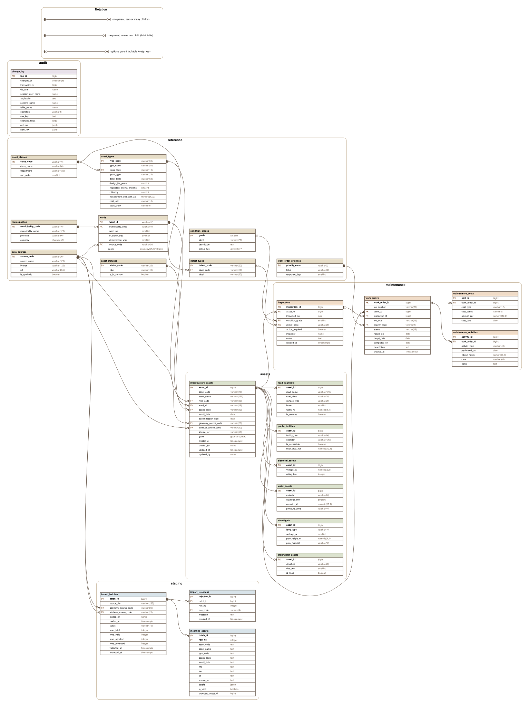

# Database architecture

GEO-ASSET ZA is a PostgreSQL 16 and PostGIS 3.4 database for a municipal infrastructure asset register, built for
wards 56, 82 and 92 of the City of Tshwane (Hatfield, Hillcrest, Brooklyn and part of Arcadia, 28 km²).



The diagram and the [data dictionary](data_dictionary.md) are generated from the live catalog by
`documentation/build_docs.py`, so they always match the schema.

## Schemas

| Schema | Holds | Who can write |
|---|---|---|
| `reference` | Wards, asset classes and types, condition grades, statuses, priorities, defects, data sources | Owner only |
| `assets` | The register (`infrastructure_assets`) and six detail tables | Manager; inspector (status only) |
| `maintenance` | Inspections, work orders, activities, costs | Manager; inspector (own inspections) |
| `operations` | Reporting views and two materialized summaries | Nobody (derived) |
| `audit` | `change_log`, written by trigger | Nobody directly |
| `staging` | Incoming batches, raw rows, validation rules, rejection log | ETL role |
| `api` | Read-only views for the public application | Nobody (derived) |
| `admin` | Migrations, backup log, job log, monitoring views | Owner only |

Separating schemas this way lets privileges be granted per schema, keeps unvalidated data physically apart from the
register, and makes the public surface (`api`) a deliberate, reviewable list of views.

## Design decisions

**One register, many asset types.** Every asset has one row in `assets.infrastructure_assets`: identity, type,
location, ward, status, dates and provenance. Attributes that only some assets have live in 1:1 detail tables
(`streetlights`, `road_segments`, `water_assets`, `electrical_assets`, `stormwater_assets`, `public_facilities`)
keyed on `asset_id`. This is class-table inheritance: maintenance tables reference one parent table whatever the
asset is, and each detail table has proper column types and CHECK constraints instead of a loose key-value store.
A trigger makes sure a detail row only exists for an asset whose type points at that detail table.

**One geometry column for points, lines and polygons.** `geom` is `geometry(Geometry, 4326)`. A trigger checks
the geometry family against `reference.asset_types.geom_type` (a road must be a line, a streetlight a point), so the
flexibility does not cost integrity, and the whole register shares one GiST index and one set of maintenance tables.
The alternative (one table per geometry type) would split every maintenance query three ways.

**WGS 84 storage, metric calculation.** Geometries are stored in EPSG:4326, the system web maps and most sources use.
Lengths and areas are calculated on the spheroid with a `::geography` cast in the views, which is accurate in metres
without picking a local projection. The [performance report](performance_report.md) shows the cost of that cast in a
WHERE clause and the pattern that keeps the index usable.

**Lookups are tables, not enums.** Asset types carry design life, inspection interval, criticality, unit cost and
code prefix; priorities carry response times. Adding a type is an insert, not a schema change.

**Derived values are never stored.** Road length, area, age, life used, latest condition and replacement value are
calculated in `operations.v_asset_register` from the geometry and the history, so they cannot disagree with them.
The two summaries that are expensive to compute are materialized views, refreshed nightly with
`REFRESH MATERIALIZED VIEW CONCURRENTLY` (each has a unique index, so readers are never blocked).

**The database enforces the rules, not the application.** Constraints and triggers reject a wrong geometry type, an
asset outside the study area, a future install date, an inspection before installation, a poor grade without a
defect, a defect from another asset class, a negative cost or a completed work order without a completion date.
Rules that depend on today's date are in triggers rather than CHECK constraints, because CHECK expressions must give
the same answer forever (a restore next year would otherwise fail). `tests/test_integrity.py` proves each rule.

**Assets with a history are never deleted.** Maintenance tables reference assets with `ON DELETE RESTRICT`.
Retiring an asset means setting the status to `DECOMMISSIONED` with a decommission date (a CHECK constraint keeps
the two consistent).

**Ward and asset code are assigned, not typed.** The insert trigger finds the ward from the geometry and generates
`SL-000123`-style codes from the type's prefix, so neither can be wrong.

**Provenance on every row.** `geometry_source_code` and `attribute_source_code` record where the location and the
attributes came from (OpenStreetMap, MDB or synthetic), and `source_ref` keeps the identifier in the source
(`node/123456789`). A partial unique index stops the same source feature being imported twice.

## Data flow

```
data/incoming/*.csv ──► staging.incoming_assets (all text)
                         │  staging.validate_batch(): 13 rules, failures to staging.import_rejections
                         ▼
                        staging.promote_batch(): one savepoint per row, constraint failures logged as R99
                         ▼
assets.infrastructure_assets + detail tables ──► maintenance.* ──► operations.* ──► api.* ──► FastAPI / static snapshot
        │                                                │
        └──────────── audit.change_log (trigger) ◄───────┘
```

## Migrations

Schema changes are versioned SQL files in `database/migrations`, applied in order by `database/migrate.py` and
recorded in `admin.schema_migrations` with a SHA-256 checksum. The runner refuses to continue if an applied file has
been edited: fixes are new migrations. V014 is an example: a test found that a function created in V013 had kept
PostgreSQL's default `EXECUTE` grant to `PUBLIC`, and V014 removes it.

| Version | Content |
|---|---|
| V001 | Extensions and schemas |
| V002 | Reference tables |
| V003 | Asset register, detail tables, validation triggers |
| V004 | Inspections, work orders, activities, costs |
| V005 | Audit log and trigger |
| V006 | Staging, validation rules, validate and promote functions |
| V007 | Reporting views and materialized summaries |
| V008 | Public API views |
| V009 | Backup and job logs, monitoring views, reporting refresh |
| V010 | Spatial and foreign-key indexes |
| V011 | Roles and privileges |
| V012 | Row-level security on inspections |
| V013 | Ownership handed to `gaz_owner` |
| V014 | Revoke a default `PUBLIC` grant found by the tests |
| V015 | Priority and performance views for the dashboard |

## Volumes in the demonstration build

| Table | Rows |
|---|---:|
| Assets | 11,879 |
| Inspections | about 98,000 |
| Work orders | about 17,600 |
| Maintenance activities | about 22,000 |
| Cost lines | about 69,000 |

Total database size is about 95 MB including indexes.
